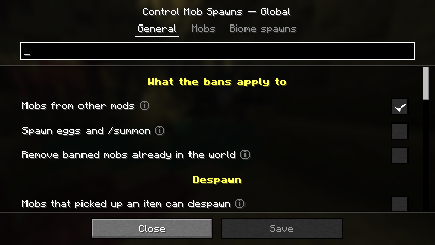
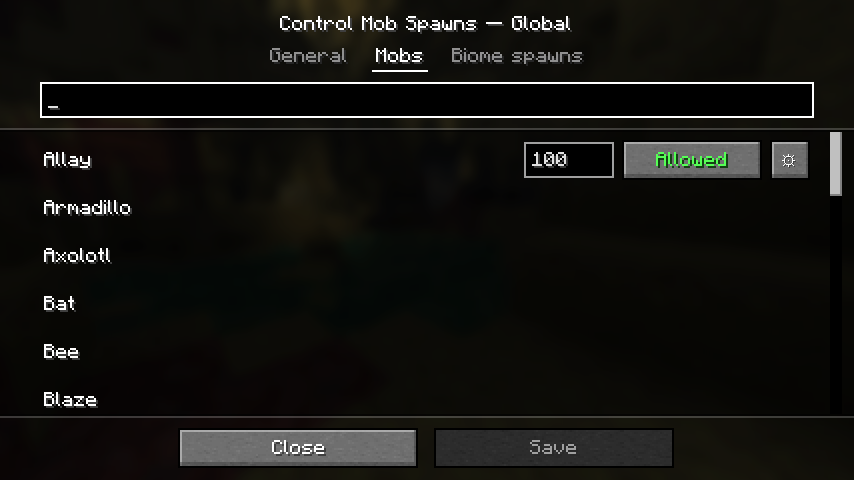
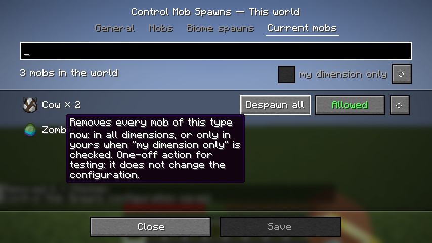
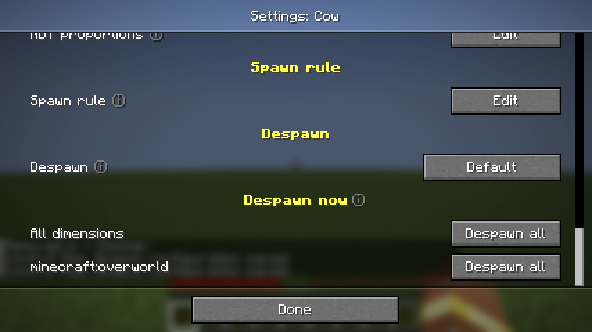
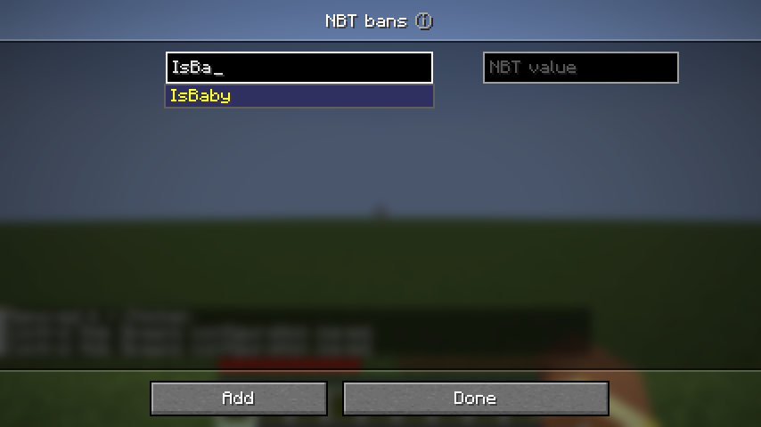

# Control Mob Spawns

A Fabric mod for Minecraft 26.2 that lets you control mob spawning from an in-game menu: ban mobs, change spawn rates and mob caps, disable spawn types, force NBT values, write custom spawn rules, add mobs to biomes and tune despawning. You never have to edit a config file by hand or look up an id.



## Features

- **Spawn rates.** Each mob gets a percentage of its natural spawn weight: 100 % is vanilla, there is no upper limit, and the value must stay above 0.
- **Bans.** You can ban a mob everywhere, in some dimensions, in some biomes or biome tags, or only when it has a given NBT value (for example `IsBaby: 1b`).
- **Spawn types.** Each mob can have its spawn reasons turned off one by one: natural, spawner, breeding, structure, patrol, spawn egg, `/summon` and so on. Disabling `NATURAL`, for instance, stops natural spawns without banning the mob.
- **NBT proportions.** You choose what share of new mobs gets a value. For example, `IsBaby: 1b` at 20 % gives 20 % baby zombies and 80 % adults.
- **Spawn rules.** A custom rule replaces a mob's own spawn conditions. It can check block light, sky light, height, the blocks below, day or night, weather and moon phase. This lets a mob spawn where it normally can't.
- **Biome spawns.** You can add any mob to the natural spawns of biomes or biome tags, with a weight and a group size.
- **Mob caps** per category (monsters, animals, ambient, water…).
- **Despawn controls:**
  - instant and random despawn distances per category;
  - *never despawn* or *force despawn* per mob;
  - an option that lets mobs which picked up an item despawn again, dropping the item.
- **Current mobs.** This tab lists the mobs in the world, most frequent first. Hovering a row shows its actions: remove all of them now (for testing), ban the mob, or open its settings.
- **NBT autocompletion.** The NBT editors suggest the mob's real paths and values while you type, and the ☰ button opens the full list. The server reads these paths from a freshly created mob and from the mobs already in the world.
- **Global and per-world configuration.** A world can override the global values, and only the values that differ are stored in the world.
- **Singleplayer and dedicated servers.** Players with the configured operator level can edit a dedicated server's configuration from their own client.
- **English and French** translations.

## Requirements

| | Version |
|---|---|
| Minecraft | 26.2 |
| Fabric Loader | 0.20.1 or newer |
| Fabric API | any version for 26.2 |
| Java | 25 |
| [Mod Menu](https://modrinth.com/mod/modmenu) | optional: adds the button that opens the menu |

## Installation

1. Install [Fabric](https://fabricmc.net/use/) for Minecraft 26.2.
2. Put `controlmobspawns-<version>.jar` and Fabric API in your `mods` folder. Add Mod Menu to get the config button.
3. On a dedicated server, install the mod on the server. Players who want to edit the configuration in game also need it on their client. Players without the mod can still join.

## Using the menu

Open **Mods → Control Mob Spawns → ⚙** (Mod Menu). It works from the title screen and from the pause menu.

- **From the title screen**, you edit the global configuration of this Minecraft instance.
- **In a world**, you first choose between the **global configuration** and **this world's configuration**. On a server, the server sends the configuration and saves your changes.

The screen has four tabs: **General**, **Mobs**, **Biome spawns** and **Current mobs**. The Current mobs tab only appears in a world. A search box above each list filters it. Changes stay pending until you press **Save**, and leaving with unsaved changes asks for confirmation.

A few conventions apply everywhere:

- Rows with several actions show them when you hover the row. Rows with a single action always show it.
- **ⓘ** explains a setting when you hover it.
- Values that differ from vanilla are shown in yellow. In the General tab, **↺** puts a value back to vanilla.
- A banned mob has its name in red.

| Mobs | Current mobs |
|---|---|
|  |  |

| Mob settings (⚙) | NBT autocompletion |
|---|---|
|  |  |

### Spawn rates and mob caps

A spawn rate only changes which mobs fill the mob cap. For example, raising zombies to 300 % makes them more common among monsters, but the total number of monsters stays the same. To get more or fewer mobs overall, change the **mob caps** in the General tab.

### Spawn types

| Type | What it covers |
|---|---|
| Natural | Regular spawning around players |
| Chunk generation | Animals placed when new terrain is generated |
| Spawner / Trial spawner | Monster spawners and trial chamber spawners |
| Structure | Mobs placed with structures (villagers, witch huts, monuments…) |
| Breeding | Babies born from two parents |
| Summoned by a mob | Iron golems from villagers, vexes from evokers… |
| Jockey | Mounts and riders created together |
| Event | Raids, wandering traders, phantoms, zombie sieges… |
| Conversion | A mob turning into another (zombie to drowned…) |
| Reinforcement | Zombies calling for help |
| Triggered | Silverfish from infested blocks, wardens… |
| Bucket | Fish and axolotls released from a bucket |
| Spawn egg / Dispenser / Command | Spawn eggs used by players or dispensers, and `/summon` |
| Patrol | Pillager patrols |

### What the bans apply to

The General tab has three switches:

- **Mobs from other mods** (on by default). When off, the settings only affect Minecraft's own mobs.
- **Spawn eggs and /summon** (off by default). When on, bans also block spawn eggs, dispensers and `/summon`. A spawn type you disabled for a mob is always blocked, whatever this switch says.
- **Remove banned mobs already in the world** (off by default). When on, banned mobs are removed when their chunk loads and when the configuration is saved. This includes named and tamed mobs.

### NBT conditions

Paths and values use the same syntax as `/data`. Some examples:

| Path | Value | Meaning |
|---|---|---|
| `IsBaby` | `1b` | Baby zombie, piglin… |
| `variant` | `"minecraft:cold"` | A specific variant |
| `CanBreakDoors` | `1b` | Zombies able to break doors |

**NBT proportions** are applied once the game has set the new mob up. Within one path, the percentages add up to at most 100 %. The rest keeps the vanilla value, except when the path has a single true/false value: then the rest gets the opposite value. Proportions are not applied to `/summon`, conversions, buckets or breeding.

The game makes some choices while setting a mob up, and changing a value afterwards does not undo them. For example, a baby zombie may already be riding a chicken, and making it an adult afterwards does not remove the chicken.

### Spawn rules

A rule starts disabled. Once you enable it, it replaces the mob's own spawn conditions; empty fields mean "no limit". The spawn position must still suit the mob (on the ground, in water…). On peaceful difficulty, monsters still don't spawn.

## Configuration files

| File | Content |
|---|---|
| `config/controlmobspawns.json` | Global configuration, used by every world |
| `<world>/serverconfig/controlmobspawns.json` | This world's overrides: only the values that differ from the global file |

You can edit the files by hand; they are read when the world or server starts. Mobs left at their default settings are not written to the file.

<details>
<summary>Example</summary>

```json
{
  "permissionLevel": 2,
  "coverage": { "moddedMobs": true, "eggsAndCommands": false, "removeExisting": false },
  "despawn": {
    "distances": { "monster": { "instant": 96, "random": 24 } },
    "itemPickersDespawn": true,
    "forceIncludesNamed": false,
    "despawnButtonCurrentDimension": false
  },
  "mobCaps": { "monster": 40 },
  "mobs": {
    "minecraft:zombie": {
      "spawnRate": 150.0,
      "banned": false,
      "bannedDimensions": [],
      "bannedBiomes": ["#minecraft:is_ocean"],
      "disabledReasons": ["REINFORCEMENT"],
      "nbtBans": [],
      "nbtProportions": [{ "path": "IsBaby", "value": "1b", "percent": 20.0 }],
      "despawn": "DEFAULT"
    },
    "minecraft:phantom": { "banned": true }
  },
  "biomeSpawns": [
    { "entity": "minecraft:blaze", "biomes": ["minecraft:desert"], "weight": 5, "minCount": 1, "maxCount": 2 }
  ]
}
```
</details>

## Permissions

On a dedicated server, editing the configuration and using **Despawn all** require the operator level set in **General → Server** (2 by default, the level of cheat commands such as `/gamemode`). The owner of a singleplayer world can always edit. Players below that level are refused, and the server checks every request itself, so modifying the client does not get around it.

## Building from source

```sh
./gradlew build                # jar in build/libs/
./gradlew runClient            # development client
./gradlew runClientGameTest    # automated tests
```

You don't need to install Java 25 yourself: Gradle downloads it automatically.

The automated tests start the game, create a world and check the bans, rates, caps, spawn rules, NBT proportions and despawn options. They also save the configuration through the screens, and connect to a dedicated server as a non-op player and then as an op. Screenshots of every screen are written to `build/run/clientGameTest/screenshots/`.

## License

[MIT](LICENSE)
